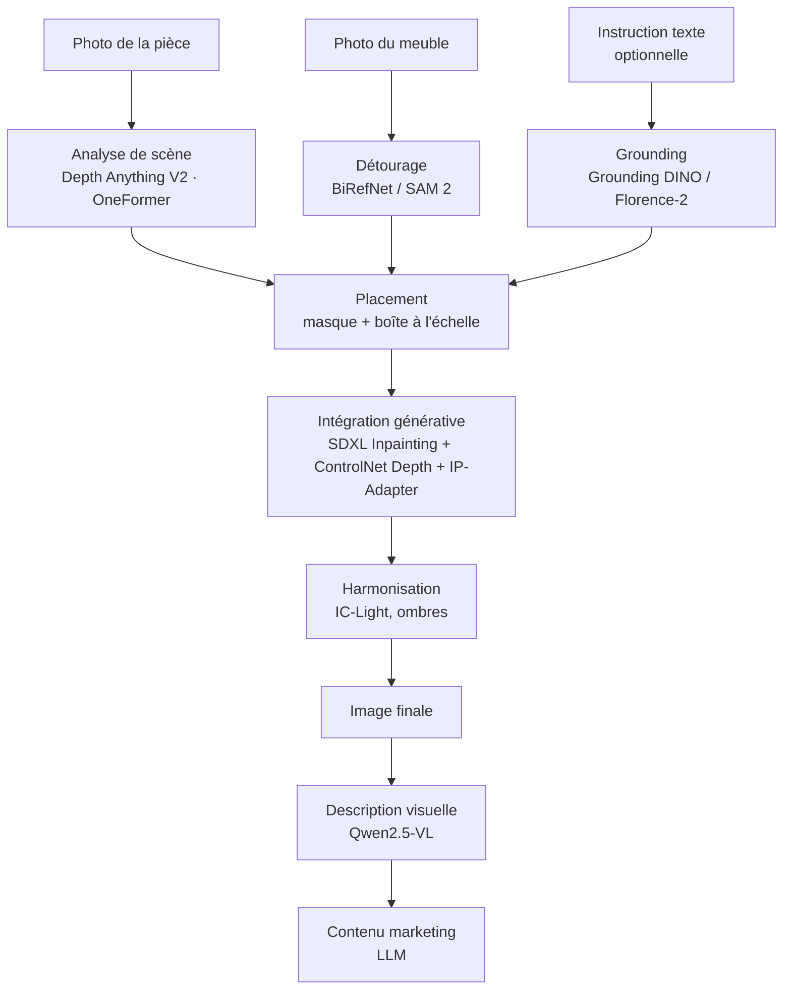

# BTL Studio

**IA générative multimodale pour l'intégration réaliste de mobilier dans des scènes réelles et la génération automatique de contenu**

Projet de fin de module — *IA générative textuelle et visuelle* · EMSI Casablanca, 5e année IA & Data
Auteur : Mustapha Lekrari · Cas d'application : Home BTL (mobilier)

[](https://colab.research.google.com/github/mustafalekrari/btl-studio/blob/main/notebooks/01_demo.ipynb)

📄 [Cahier des charges (PDF)](docs/cahier_des_charges.pdf) · 📓 [Journal de bord](docs/journal.md)

---

## Objectif

À partir d'une **photo de pièce** et d'une **photo de meuble** (catalogue Home BTL), produire :

1. une **image photoréaliste** où le meuble est intégré (perspective, échelle, lumière, ombres) ;
2. le **contenu marketing** associé (description produit, légende réseaux sociaux, hashtags).

## Architecture



## Avancement

| Jours | Tâche | Statut |
| --- | --- | --- |
| J1–J2 | État de l'art, environnement GPU, jeu de test, démo Gradio (profondeur + détourage + baseline) | 🟡 En cours |
| J3–J4 | Détourage, profondeur, segmentation de scène (F2, F3) | ⚪ À faire |
| J5–J7 | Placement + inpainting SDXL / ControlNet / IP-Adapter (F4, F6) — **jalon mi-parcours** | ⚪ À faire |
| J8–J9 | Harmonisation IC-Light, ombres, placement par texte (F5, F7) | ⚪ À faire |
| J10 | VLM + LLM : génération de contenu (F8) | ⚪ À faire |
| J11–J12 | API FastAPI + interface, évaluation et ablations | ⚪ À faire |
| J13–J14 | Rapport, vidéo de démo, soutenance | ⚪ À faire |

Légende : ⚪ à faire · 🟡 en cours · 🟢 terminé

## Structure du dépôt

```
btl-studio/
├── configs/default.yaml        # identifiants des modèles et paramètres
├── data/                       # scènes et meubles (non versionnés, voir data/README.md)
├── docs/                       # cahier des charges, journal de bord, rapport
├── notebooks/00_setup_colab.ipynb
├── scripts/check_env.py        # vérification de l'environnement + test GPU
├── src/btl_studio/             # pipeline (un module par étape)
│   ├── scene_analysis.py       # profondeur + segmentation
│   ├── cutout.py               # détourage du meuble
│   ├── grounding.py            # texte -> zone cible
│   ├── placement.py            # masque + mise à l'échelle
│   ├── integration.py          # inpainting conditionné
│   ├── harmonization.py        # relighting + ombres
│   ├── content_generation.py   # VLM + LLM
│   ├── evaluation.py           # métriques
│   └── pipeline.py             # orchestration
├── app/                        # API FastAPI + démo
└── tests/
```

## Installation

### Option A — Google Colab / Kaggle (GPU recommandé)

Ouvrir `notebooks/00_setup_colab.ipynb` et exécuter les cellules (runtime GPU T4 ou mieux).

### Option B — Machine locale avec GPU NVIDIA (≥ 16 Go VRAM conseillés)

```bash
git clone https://github.com/mustafalekrari/btl-studio.git
cd btl-studio
conda env create -f environment.yml
conda activate btl-studio
pip install -e .
python scripts/check_env.py
```

Sans conda :

```bash
python -m venv .venv
source .venv/bin/activate          # Windows : .venv\Scripts\activate
pip install torch torchvision --index-url https://download.pytorch.org/whl/cu121
pip install -r requirements.txt
pip install -e .
python scripts/check_env.py
```

## Licences des modèles

SDXL (OpenRAIL++) est la base retenue car compatible avec un usage commercial ultérieur. FLUX.1 [dev] (licence non commerciale) n'est utilisé qu'à titre de comparaison expérimentale.
